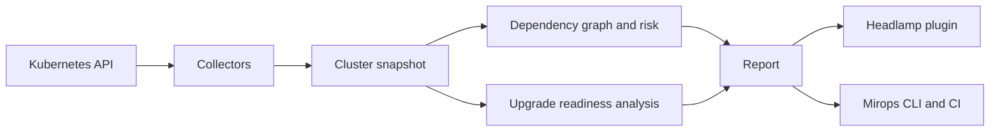
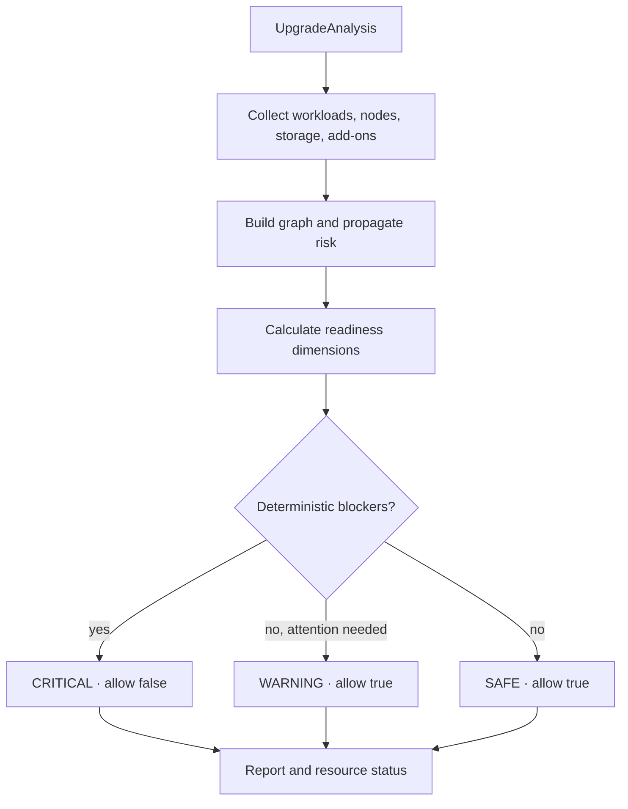

# Mirops Kubernetes operator

> **See what breaks before it does.**

Mirops evaluates Kubernetes upgrade readiness from a collected cluster snapshot. It builds a dependency graph, checks add-on compatibility, reports health and risk signals, and returns a deterministic decision with the reasons behind it.

[](LICENSE)



## How an analysis works

Create an `UpgradeAnalysis` for a target Kubernetes version. The operator collects cluster state, evaluates health, capacity, stability, compatibility, and drain blockers, then writes a report and status fields for `kubectl` and the consuming tools.



## What ships

- **Kubernetes inventory:** workloads, services, nodes, PVCs, disruption budgets, detected add-ons, and deprecated APIs.
- **Dependency graph:** models relationships among collected components and propagates risk to dependents.
- **Upgrade decision:** returns `SAFE`, `WARNING`, `CRITICAL`, or `ERROR`, with `decision.allow` and blocker details.
- **Compatibility evaluation:** checks detected add-ons against the target Kubernetes version using the embedded matrix or the `mirops-compatibility-matrix` ConfigMap.
- **Report destinations:** file, Amazon S3, Azure Blob Storage, and PVC.
- **Optional AI scoring:** can add reasoning and adjust the readiness score; it cannot determine whether an upgrade is blocked.
- **Approval-based remediation:** optional `RemediationPlan` resources can propose actions for review and execution.

## Readiness and decision

The score is a 0–100 health gauge. The upgrade gate is the deterministic decision in the report; the score alone never blocks an upgrade.

| Dimension | Weight | Signals |
| --- | ---: | --- |
| Health | 25 | Pod readiness and restarts. |
| Capacity | 30 | CPU and memory requests against allocatable capacity. |
| Stability | 20 | Crash loops, restart trend, and pod changes between runs. |
| Compatibility | 25 | Add-on compatibility and deprecated API findings. |

The built-in profiles tune thresholds for unstable pods and the score required for `SAFE`:

| Profile | Warning above not-ready | Block above not-ready | SAFE score |
| --- | ---: | ---: | ---: |
| `production` (default) | 5% | 30% | 90 |
| `non-production` | 15% | 60% | 85 |

Deterministic blockers include incompatible add-ons, lost PVCs, a PodDisruptionBudget that stalls node drain, CPU or memory pressure above 90%, and pods not ready beyond the selected profile’s block threshold. A low score or propagated graph risk alone is not a blocker.

## Install

The operator defines cluster-scoped `UpgradeAnalysis` and `RemediationPlan` resources. Install their CRDs before creating resources, then install the Helm chart:

```sh
kubectl apply -f config/crd/bases/
helm install mirops ./mirops-operator \
  --namespace mirops \
  --create-namespace
```

For chart values and published release instructions, see the [Helm charts repository](https://github.com/miropshq/helm-charts).

## Create an analysis

```yaml
apiVersion: mirops.mirops.io/v1
kind: UpgradeAnalysis
metadata:
  name: to-1-34
spec:
  targetVersion: "1.34"
  scoringProfile: production
  scope:
    mode: application
    excludeNamespaces:
      - monitoring
  source:
    type: file
```

```sh
kubectl apply -f analysis.yaml
kubectl get upgradeanalysis to-1-34
kubectl describe upgradeanalysis to-1-34
```

Both custom resources are cluster-scoped. Select `scope.mode: all` to include system namespaces or `application` to focus on application namespaces.

## Reports and storage

The report includes the target and cluster versions, decision, blockers, score breakdown, health and compatibility findings, workloads, graph, add-on results, and optional AI reasoning.

| Destination | Configuration | Notes |
| --- | --- | --- |
| File | `source.type: file`, optional `path` | Default; written in the operator’s reports directory. |
| Amazon S3 | `source.type: s3` | Configure bucket, region, object key, and optional credentials Secret; IRSA can be used. |
| Azure Blob | `source.type: blob` | Configure account, container, blob, and optional credentials Secret; Workload Identity can be used. |
| PVC | `source.type: pvc` | Persistent Kubernetes storage, mounted through chart values. |

The operator report service serves reports to the Headlamp plugin. For cloud destinations, configure the operator’s identity or Secret; consumers use their own credentials when reading remote report sources directly.

## Optional AI and remediation

AI is off by default. Configure a Kubernetes Secret containing `ANTHROPIC_API_KEY` or `OPENAI_API_KEY`, then reference it in `spec.ai.credentialsSecret`. AI blends its score with the deterministic base score (70% base, 30% AI) and can provide reasoning. It cannot block or unblock an upgrade.

When remediation suggestions are enabled, the operator creates a `RemediationPlan`. Review proposed actions and approve execution through the resource’s approval field. Remediation does not perform an upgrade automatically.

## Compatibility matrix

The operator embeds a compatibility snapshot in its image. Administrators may override it with a ConfigMap named `mirops-compatibility-matrix`; the separate [mirops-compat catalog](https://github.com/miropshq/mirops-compat) maintains source rules and published snapshots. Unknown compatibility and known incompatibility are distinct results.

## Development

Requires Go 1.24.6 or newer.

```sh
go test ./...
make manifests
make lint
make run
```

Use the project’s Makefile for other generation and build targets. Keep generated CRDs and code synchronized with API type changes.

## Ecosystem and contribution

- [Mirops CLI](https://github.com/miropshq/mirops-cli) renders reports and enforces decisions in CI/CD.
- [Headlamp plugin](https://github.com/miropshq/mirops-headlamp-plugin) visualizes analyses, findings, and remediation plans.
- [Helm charts](https://github.com/miropshq/helm-charts) package deployment.
- [Compatibility catalog](https://github.com/miropshq/mirops-compat) maintains add-on support data.

Mirops is open source under Apache-2.0. See [CONTRIBUTING.md](CONTRIBUTING.md) and [LICENSE](LICENSE).

