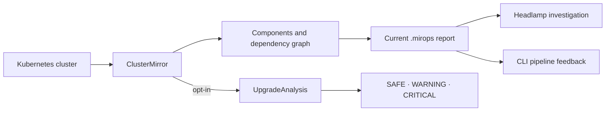
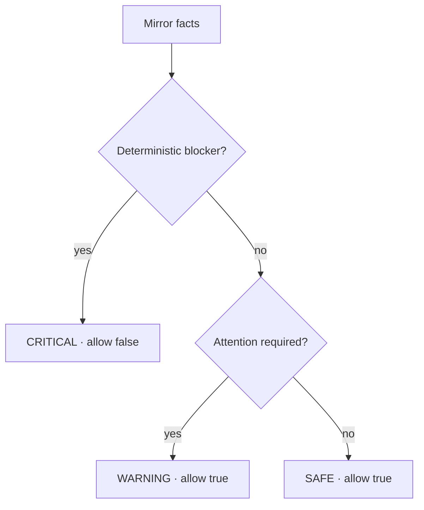

# Mirops — mirror operations

> **See what breaks before it does.**

Mirops builds an always-on logical mirror of a Kubernetes cluster: its components, dependencies, and current blast radius. Upgrade analysis is an opt-in operation on that mirror, producing an explainable decision with the blockers that need attention.

[](LICENSE)



## Why a mirror?

The mirror separates observation from change. It continuously collects cluster state, models workloads, services, nodes, PVCs, add-ons, and configuration as a dependency graph, then exposes current risk by namespace. That gives platform teams a useful view every day—not only when an upgrade is planned.

When upgrade analysis is enabled, Mirops evaluates a target Kubernetes version on that same mirror. The result is explainable: `decision.allow`, `decision.level`, and `decision.blockers` are the gate; the 0–100 health score is a separate readiness gauge.

## What the operator provides

| Capability | What it means |
| --- | --- |
| **ClusterMirror** | Continuously rebuilds current cluster state and writes a `<name>.mirops` report. |
| **Dependency risk** | Shows what depends on an at-risk component and where its blast radius lands. |
| **UpgradeAnalysis** | Optional target-version analysis with deterministic blockers and a clear decision. |
| **Compatibility** | Evaluates detected add-ons against the target Kubernetes version. |
| **Reports** | Serves reports and supports file, S3, Azure Blob, and PVC destinations. |
| **RemediationPlan** | Proposes explicit, approval-based actions; it never auto-remediates or auto-upgrades. |
| **Optional AI copilot** | Adds reasoning when configured; it cannot block or unblock a decision. |

## The decision model



A lost PVC, incompatible add-on, drain-blocking PDB, hard CPU/memory pressure, or configured pods-not-ready threshold can block an upgrade. The score never independently blocks it.

## Get started

Install the operator through the [Helm chart](https://github.com/miropshq/helm-charts), then create a `ClusterMirror`:

```sh
helm install mirops oci://ghcr.io/miropshq/charts/mirops \
  --namespace mirops \
  --create-namespace \
  --version <chart-version>

kubectl apply -f cluster-mirror.yaml
kubectl get clustermirror
```

Use the [documentation portal](https://docs.mirops.com) for the CRD reference, report destinations, and a complete first-mirror workflow.

## Ecosystem

- [**Mirops CLI**](https://github.com/miropshq/mirops-cli) reads reports in terminals and CI/CD.
- [**Headlamp plugin**](https://github.com/miropshq/mirops-ui) makes dependencies, risk, and findings explorable in Kubernetes UI.
- [**Helm charts**](https://github.com/miropshq/helm-charts) package installation.
- [**Compatibility catalog**](https://github.com/miropshq/mirops-compat) maintains add-on support rules.

## Develop and contribute

```sh
go test ./...
make manifests
make lint
make run
```

Mirops is open source under Apache-2.0. Contributions that improve real-world cluster understanding, documentation, and compatibility evidence are welcome; start with [CONTRIBUTING.md](CONTRIBUTING.md) and [LICENSE](LICENSE).

