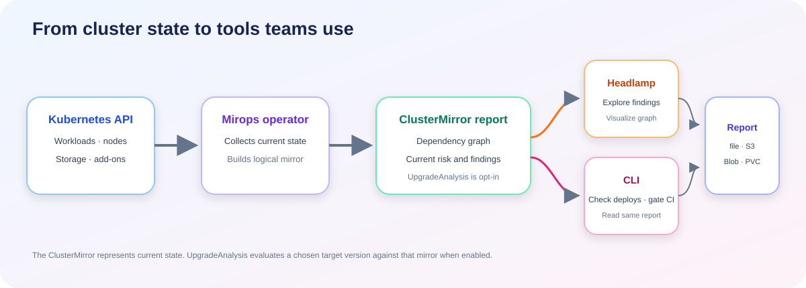
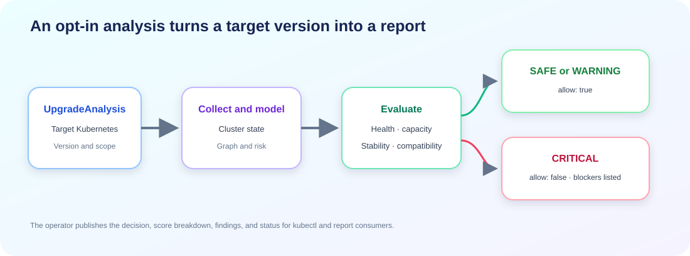
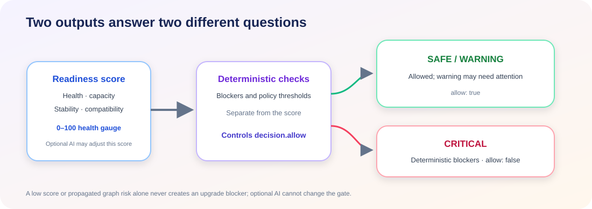
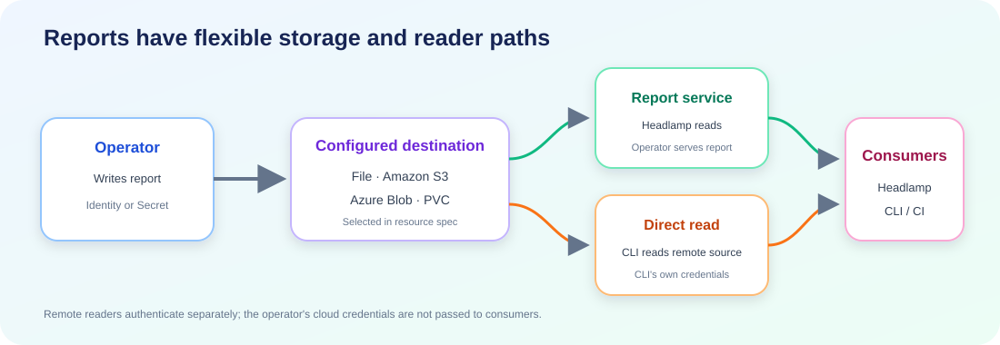

# Mirops Kubernetes operator

> **See what breaks before it does.**

Mirops keeps a **live mirror of your Kubernetes cluster** — every workload, Service, volume and add-on, what depends on what, and what is broken right now. When something fails you already know its blast radius, and before you change something you can check what the change would break.

The mirror is a model, not a copy: nothing runs in it. The operator rebuilds it on an interval and publishes it as a report that [Headlamp](https://github.com/miropshq/mirops-headlamp-plugin) shows and the [CLI](https://github.com/miropshq/mirops-cli) checks deploys against. **Upgrade analysis** is an opt-in operation on the same model, for when a Kubernetes upgrade is coming.

[](LICENSE)



## What ships

- **ClusterMirror** — the always-on mirror. A dependency graph of workloads, Services, Ingresses, ConfigMaps and Secrets, PVCs, nodes and add-ons, rebuilt every 5 minutes by default, with the current risk of every component and namespace.
- **Risk propagation** — whatever is down, pending or lost raises the risk of everything that depends on it, and adds up per namespace.
- **Reports** — every mirror and analysis writes `<name>.mirops` to a file, Amazon S3, Azure Blob Storage or a PVC, and the operator serves them to Headlamp.
- **Upgrade analysis (opt-in)** — an `UpgradeAnalysis` builds the same mirror and evaluates it against a target Kubernetes version: add-on compatibility, removed APIs, drain blockers, a 0–100 readiness score and a deterministic `SAFE`, `WARNING` or `CRITICAL` verdict.
- **Optional AI and remediation** — for upgrade analysis: AI reasoning that nudges the score, never the verdict, and `RemediationPlan` actions that run only after you approve them.

All three resources — `ClusterMirror`, `UpgradeAnalysis` and `RemediationPlan` — are cluster-scoped.

## Install

The operator installs its own CRDs at startup, so a Helm install is all it takes:

```sh
helm install mirops oci://ghcr.io/miropshq/charts/mirops \
  --namespace mirops --create-namespace --version 0.2.0
```

The chart creates no `ClusterMirror` — you create one next. For cloud credentials, PVC reports and every value, see the [Helm charts repository](https://github.com/miropshq/helm-charts) and the [docs](https://docs.mirops.com/helm/deploy).

## Create a ClusterMirror

```yaml
apiVersion: mirops.mirops.io/v1
kind: ClusterMirror
metadata:
  name: default
spec:
  scope:
    mode: application        # all (default) | application — skips kube-system and the other system namespaces
    excludeNamespaces: [monitoring]
  refresh:
    interval: 5m
  source:
    type: s3                 # file (default) | s3 | blob | pvc
    bucket: my-reports
    region: us-east-1
    key: prod/default.mirops
```

```sh
kubectl apply -f mirror.yaml
kubectl get clustermirror
# NAME      COMPONENTS   EDGES   AT RISK   LAST SYNC   AGE
# default   184          297     3         30s         1h
```

Every field has a default — `spec: {}` mirrors every namespace every 5 minutes and writes `default.mirops` inside the operator pod. You can also create one from Headlamp: **Mirops → Cluster Mirror → New mirror**.

The mirror's status carries its components, dependency edges, components at risk and the risk per namespace (`status.byNamespace`); the full picture — what is at risk and what depends on it — is in the report.

## Check a deploy against the mirror

In a pipeline, the [CLI](https://github.com/miropshq/mirops-cli) reads the mirror's report and the change you're about to apply — manifests, Helm, Kustomize or a Terraform plan — and blocks the deploy only when the change would break something running:

```sh
export MIROPS_SOURCE=s3://my-reports/prod/default.mirops
mirops scan -f k8s/ -n payments --enforce
```

```text
✗ BLOCK deployment/reports-worker mounts pvc/payments-db-data, which is Pending — pods that mount it won't start
```

It reads the report, never the cluster — with the report in S3 or Azure Blob, the pipeline needs no kubeconfig. A change to something that is already down is context, not a failure: the deploy may be the fix. See [Check a deploy against the mirror](https://docs.mirops.com/guides/getting-started/check-a-deploy).

## Upgrade analysis (opt-in)

The operator always runs the ClusterMirror controller. The `UpgradeAnalysis` controller runs only when the chart enables it — while it's off, an `UpgradeAnalysis` is never processed:

```sh
helm upgrade mirops oci://ghcr.io/miropshq/charts/mirops -n mirops --reuse-values \
  --set upgrade.enabled=true
```

Then create an analysis for the target version:

```yaml
apiVersion: mirops.mirops.io/v1
kind: UpgradeAnalysis
metadata:
  name: to-1-34
spec:
  targetVersion: "1.34"
  scoringProfile: production
  scope:
    mode: application
  source:
    type: file
```

```sh
kubectl apply -f analysis.yaml
kubectl get upgradeanalysis to-1-34
```



### Readiness and decision

The analysis returns two separate things. The **score** is a 0–100 health gauge; the **decision** is the upgrade gate, and the score alone never blocks.

| Dimension | Weight | Signals |
| --- | ---: | --- |
| Health | 25 | Pod readiness and restarts. |
| Capacity | 30 | CPU and memory requests against allocatable capacity. |
| Stability | 20 | Crash loops, restart trend, and pod changes between runs. |
| Compatibility | 25 | Add-on compatibility and deprecated API findings. |

The built-in profiles tune thresholds for unstable pods and the score required for `SAFE`:

| Profile | Warning above not-ready | Block above not-ready | SAFE score |
| --- | ---: | ---: | ---: |
| `production` (default) | 5% | 30% | 90 |
| `non-production` | 15% | 60% | 85 |

Deterministic blockers — incompatible add-ons, lost PVCs, a PodDisruptionBudget that stalls node drain, CPU or memory pressure above 90%, and pods not ready beyond the profile's block threshold — make the decision `CRITICAL` with `decision.allow: false`, whatever the score. A low score or propagated risk alone is not a blocker. In CI, `mirops scan --upgrade --enforce` gates on that decision.



### Optional AI and remediation

AI is off by default. Configure a Kubernetes Secret containing `ANTHROPIC_API_KEY` or `OPENAI_API_KEY`, then reference it in `spec.ai.credentialsSecret`. AI blends its score with the deterministic base score (70% base, 30% AI) and can provide reasoning. It cannot block or unblock an upgrade.

When remediation suggestions are enabled, the operator creates a `RemediationPlan`. Review the proposed actions and approve execution through the resource's approval field. Remediation never performs the upgrade itself.

## Reports and storage

A ClusterMirror and an UpgradeAnalysis take the same report destinations, in `spec.source`, and both write `<name>.mirops`:

| Destination | Configuration | Notes |
| --- | --- | --- |
| File | `source.type: file`, optional `path` | Default; written in the operator's reports directory. |
| Amazon S3 | `source.type: s3` | Bucket, region, object key, and an optional credentials Secret; IRSA on EKS. |
| Azure Blob | `source.type: blob` | Account, container, blob, and an optional credentials Secret; Workload Identity on AKS. |
| PVC | `source.type: pvc` | Persistent Kubernetes storage, mounted through chart values. |

The operator's report service (`:8084`) serves them to Headlamp at `/reports/<name>.mirops` — `?kind=ClusterMirror` for a mirror. For cloud destinations, configure the operator's identity or Secret; the CLI reads remote reports with its own credentials.



## Compatibility matrix

Upgrade analysis checks add-ons against a compatibility snapshot embedded in the operator image. Administrators may override it with a ConfigMap named `mirops-compatibility-matrix`; the separate [mirops-compat catalog](https://github.com/miropshq/mirops-compat) maintains source rules and published snapshots. Unknown compatibility and known incompatibility are distinct results.

## Development

Requires Go 1.24.6 or newer.

```sh
go test ./...
make manifests
make lint
make run
```

Use the project's Makefile for other generation and build targets. Keep generated CRDs and code synchronized with API type changes.

## Ecosystem and contribution

- [Mirops CLI](https://github.com/miropshq/mirops-cli) — checks a deploy against the mirror in CI/CD, shows a namespace's state, and gates upgrades on the analysis.
- [Headlamp plugin](https://github.com/miropshq/mirops-headlamp-plugin) — the Cluster Mirror page (create mirrors, explore risk and the dependency graph), upgrade analyses, and remediation plans.
- [Helm charts](https://github.com/miropshq/helm-charts) — install the operator.
- [Compatibility catalog](https://github.com/miropshq/mirops-compat) — add-on support data.
- [Documentation](https://docs.mirops.com).

Mirops is open source under Apache-2.0. See the repository [LICENSE](LICENSE), and contribute a focused pull request that keeps implementation, tests, and documentation aligned.
